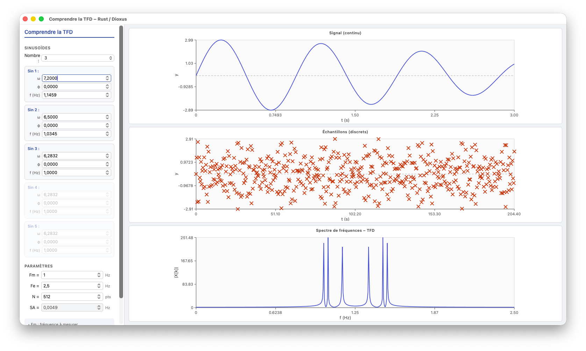

# Comprendre la Transformation de Fourier Discrète (TFD)

Application interactive pour comprendre et visualiser la Transformation de Fourier Discrète (TFD).


## Application Rust / Dioxus

Le projet a été converti de C++/Qt vers **Rust** avec l'interface graphique **Dioxus 0.7.3** (desktop).



### Compilation et lancement

```bash
# Avec dioxus-cli
dx serve
```

### Fonctionnalités

- **Jusqu'à 5 sinusoïdes** configurables indépendamment (ω, φ, fréquence)
- **Visualisation du signal** continu (3 périodes)
- **Visualisation de l'échantillonnage** discret (N points à Fe Hz)
- **Calcul de la TFD** (algorithme O(N²) pédagogique) et affichage du spectre
- **Paramètres** : Fm (fréquence à mesurer), Fe (fréquence d'échantillonnage), N (nombre de points), SA (précision spectrale = Fe/N)
